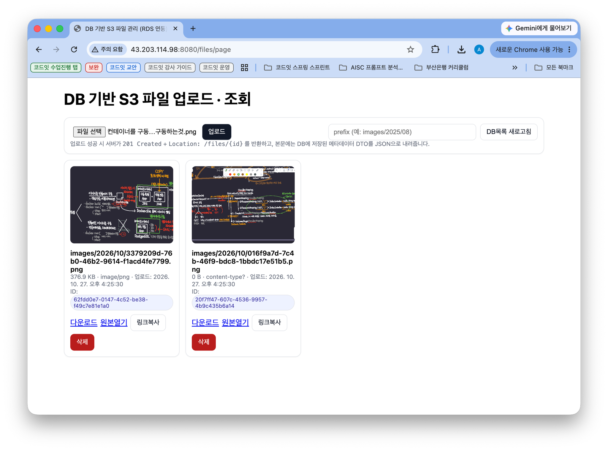
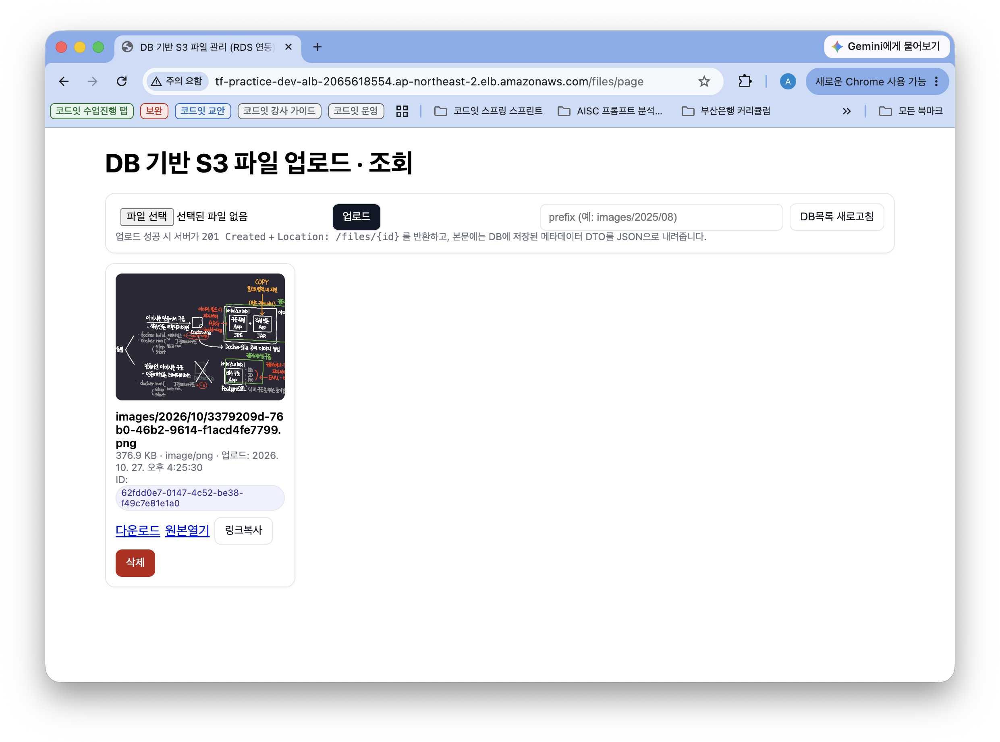

# aws-terraform-template

단일 서버 운영에 필요한 AWS 인프라를 Terraform 으로 단계별로 쌓아가는 실습 템플릿입니다.

| 단계 | 브랜치                                | 추가되는 내용                                                                         |
| ---- | ------------------------------------- | ------------------------------------------------------------------------------------- |
| 0차  | `base/aws-vpc-nat-and-bastion`        | VPC, IGW, 공개/사설 서브넷, NAT 인스턴스, Bastion, Private EC2                        |
| 1차  | `add-on-base/1-aws-elb`               | ELB(L7-ALB) 연결하여 사설 서브넷 내 EC2 외부로 서비스 서빙                            |
| 2차  | `add-on-base/2-aws-rds-and-s3`        | 데이터베이스 서버를 위한 보조 CIDR + DB 전용 서브넷 2개, RDS(PostgreSQL)              |
| 3차  | `add-on-base/2-aws-rds-and-s3`        | S3 버킷(공개 읽기, CORS, 암호화) + 스프링 앱용 IAM 사용자/액세스 키                   |
| 4차  | `add-on-base/3-aws-ecr-and-ecs`       | ECR(이미지 저장소) + ECS Fargate(클러스터, 태스크 정의, 서비스) + GitHub Actions 배포 |
| 5차  | `add-on-base/4-aws-ecs-and-elb`       | ECS 를 사설 서브넷으로 숨기고 ALB 연결, ALB 하나를 포트로 분기 (:80 ECS / :8080 EC2)  |
| 6차  | `add-on-base/5-aws-cloudwatch-on-ecs` | ECS 컨테이너 로그(CloudWatch Logs) + CPU / 메모리 / ERROR 로그 알람 → SNS 이메일      |

## 디렉터리 구조

```
main.tf                       # 모듈 조립 (여기서 전체 구조를 한눈에 본다)
variables.tf / outputs.tf     # 루트 변수 / 적용 후 확인할 값
module/common/*               # VPC, 서브넷, IGW, 라우팅 테이블 (네트워크 부품)
module/network                # 네트워크 부품을 묶은 모듈
module/resource/sg            # 보안 그룹 모음
module/resource/ec2           # Bastion, NAT, Private EC2
module/resource/elb           # [1차] ALB, 대상 그룹, 리스너 → [5차] ECS(ip) / EC2(instance) 대상 그룹 + 리스너 2개
module/resource/rds           # [2차] DB 서브넷 그룹 + PostgreSQL
module/resource/s3            # [3차] S3 버킷 + 스프링 앱 사용자에게 붙이는 버킷 권한
module/resource/ecr           # [4차] ECR 저장소 + 오래된 이미지 정리 라이프사이클
module/resource/ecs           # [4차] ECS 클러스터, 플레이스홀더 태스크 정의, 서비스, 실행 역할 → [6차] CloudWatch 로그 그룹(logs.tf)
module/resource/monitoring    # [6차] SNS 토픽 + 이메일 구독(sns.tf), CPU / 메모리 / ERROR 로그 알람(cloudwatch.tf)
```

## 0차: AWS VPC + SG + EC2 (Private 1 + Public 2)

```
   개발자 PC                    Internet
       │                            ▲
       │ SSH 22                     │
       │                         [ IGW ]
       │                            │
 ┌─────┼────────────────────────────┼──────── VPC 10.0.0.0/24 ────────────────┐
 │     │  ap-northeast-2a           │        ap-northeast-2b                  │
 │ ┌───▼─ 공개 서브넷 10.0.0.0/26 ──┼───┐  ┌─ 공개 서브넷 10.0.0.64/26 ─────┐ │
 │ │ Bastion              NAT 인스턴스  │  │ (비어 있음)                    │ │
 │ │ (bastion-sg)      (nat-instance-sg)│  │                                │ │
 │ └───┼────────────────────────────▲───┘  └────────────────────────────────┘ │
 │     │ SSH 22                     │ 0.0.0.0/0 (사설 → 인터넷)               │
 │ ┌───▼────────────────────────────┼───┐  ┌────────────────────────────────┐ │
 │ │ Private EC2 (private-server-sg)    │  │ (비어 있음)                    │ │
 │ └───── 사설 서브넷 10.0.0.128/26 ────┘  └─ 사설 서브넷 10.0.0.192/26 ────┘ │
 └────────────────────────────────────────────────────────────────────────────┘
```

- **Bastion**: 개발자 IP(와 EC2 Instance Connect)에서 오는 SSH 22 만 허용합니다. 사설 서브넷으로 들어가는 유일한 입구입니다.
- **NAT 인스턴스**: 사설 서브넷에서 나가는 트래픽(`dnf`, 외부 API 등)을 대신 인터넷으로 내보냅니다. 들어오는 연결은 받지 않습니다.
- **Private EC2**: 공인 IP 가 없고, Bastion SG 에서 오는 SSH 22 만 허용합니다.
- 서브넷을 AZ 2개에 나눠 둔 것은 1차의 ALB(최소 2개 AZ 필요)와 이후 RDS 서브넷 그룹을 위한 준비입니다.

### 적용

테라폼 명령어를 수행하기전에는 항상 테라폼이 AWS 서비스들에 대한 CRUD 위해
AWS IAM 사용자 계정 만들어서 테라폼 명령어를 수행하는 디렉토리에서 AWS_ACCESS_KEY_ID 등의 환경변수가 설정되어있어야 한다

```bash
terraform init
terraform plan
terraform apply
```

### 확인

첫번째 터미널에서 수행

```bash
eval "$(terraform output -raw ssh_tunnel_to_private_server)"
```

```bash
# 위 명령어는 실제 아래와 똑같이 수행되는것 (아래 명령어에 채워진 IP 주소는 예시)
ssh -i local-to-bastion.pem -N -L 33322:10.0.0.138:22 ec2-user@15.165.15.132
```

두번째 터미널에서 수행

```bash
eval "$(terraform output -raw ssh_to_private_server)"
```

```bash
# 위 명령어는 실제 아래와 똑같이 수행되는것 (아래 명령어에 채워진 IP 주소는 예시)
ssh -i local-to-private.pem -p 33322 -o StrictHostKeyChecking=no -o UserKnownHostsFile=/dev/null ec2-user@localhost
```

실제 Private Subnet 내 인스턴스에 접속이 완료되었다면, 아래 명령어를 수행해서 NAT 인스턴스가 잘 연결되어있나 확인

```bash
ping google.com
```

### 정리

```bash
terraform destroy
```

## 1차: ELB(ALB) + Private EC2

```
                         사용자 브라우저 / curl
                                  │ HTTP 80  (http://<alb_dns_name>)
                                  ▼
 ┌─ VPC 10.0.0.0/24 ──────────────┼──────────────────────────────────────────┐
 │                             [ IGW ]                                        │
 │                                │                                           │
 │      ap-northeast-2a           │             ap-northeast-2b               │
 │ ┌─ 공개 서브넷 10.0.0.0/26 ──────┼───┐ ┌─ 공개 서브넷 10.0.0.64/26 ───────┐   │
 │ │                     ┌─────────▼───┴─┴─────────────────────┐          │   │
 │ │ Bastion   NAT       │  ALB (alb-sg)   리스너 HTTP:80        │          │   │
 │ │                     │  AZ 마다 노드가 하나씩 뜬다              │          │   │
 │ │                     └─────────┬───┬─┬─────────────────────┘          │   │
 │ └───────────────────────────────┼───┘ └──────────────────────────────────┘   │
 │                                 │ 대상 그룹 (instance, :8080)                  │
 │                                 │ + 헬스체크 GET / → 200                       │
 │ ┌─ 사설 서브넷 10.0.0.128/26 ──────▼──┐ ┌─ 사설 서브넷 10.0.0.192/26 ┐          │
 │ │ Private EC2 :8080                  │ │        (비어 있음)          │          │
 │ │ (private-server-sg: alb-sg → 8080) │ │                            │          │
 │ └────────────────────────────────────┘ └────────────────────────────┘          │
 └──────────────────────────────────────────────────────────────────────────────┘
```

- **ALB 는 공개 서브넷, 서버는 사설 서브넷**: 인터넷에서 보이는 것은 ALB 뿐이고, Private EC2 는 여전히 공인 IP 없이 사설 서브넷에 있습니다.
- **ALB 는 서로 다른 AZ 의 서브넷이 최소 2개 필요**합니다. 그래서 0차에서 공개 서브넷을 2a / 2b 에 하나씩 만들어 두었습니다.
- **SG → SG 허용**: `private-server-sg` 는 IP 가 아니라 _ALB 의 SG(`alb-sg`)_ 에서 오는 `target_instance_port`(기본 8080) 만 허용합니다. ALB 를 거치지 않은 요청은 서버까지 오지 못합니다.
- **리소스 4개**: `aws_lb`(입구) → `aws_lb_listener`(80 으로 받은 요청을) → `aws_lb_target_group`(어디로 보낼지 + 헬스체크) ← `aws_lb_target_group_attachment`(Private EC2 등록)
- EC2 를 대상으로 하므로 대상 그룹의 `target_type` 은 `instance` 입니다. (ECS Fargate 를 붙일 때는 `ip`)

### 적용

```bash
terraform apply
```

apply 직후에는 Private EC2 에 8080 으로 응답하는 서버가 없어서 대상 그룹이 `unhealthy` 이고, ALB 는 `502 Bad Gateway` 를 돌려줍니다. 0차의 방법으로 Private EC2 에 접속해서 테스트용 웹 서버를 띄웁니다.

```bash
# Private EC2 안에서 (NAT 인스턴스 덕분에 dnf 가 동작한다)
echo "hello from private ec2" > index.html
nohup python3 -m http.server 8080 > /dev/null 2>&1 &
```

### 확인

```bash
# 1) 대상 그룹 헬스체크 상태: healthy 가 될 때까지 30초 간격으로 2번 성공해야 한다 (약 1분)
aws elbv2 describe-target-health --target-group-arn $(terraform output -raw ec2_target_group_arn)

# 2) ALB 를 통해 호출 (ALB 생성 직후에는 DNS 전파에 1~2분 걸릴 수 있다)
curl "http://$(terraform output -raw alb_dns_name)"
```

- `unhealthy` 일 때 `Reason` 으로 원인을 구분합니다. `Target.Timeout` 이면 SG 또는 서버 미기동, `Target.ResponseCodeMismatch` 면 헬스체크 경로가 200 을 돌려주지 않는 것입니다.

### 정리

```bash
terraform destroy
```

## 2차: RDS(PostgreSQL)

```
                        사용자 (브라우저 / curl)
                                 │ HTTP 80  http://<alb_dns_name>
                                 │
                              [ IGW ]
                                 │
 ┌───────────────────────────────┼─ VPC 10.0.0.0/24 + 보조 CIDR 10.1.0.0/24 ──┐
 │  ap-northeast-2a                          ap-northeast-2b                  │
 │ ┌─ 공개 서브넷 10.0.0.0/26 ───┼──────┐  ┌─ 공개 서브넷 10.0.0.64/26 ─────┐ │
 │ │              ┌──────────────▼──────────────────────────┐               │ │
 │ │              │ ALB (alb-sg)   리스너 HTTP:80           │               │ │
 │ │ Bastion      │ AZ 마다 노드가 1개씩 (2a, 2b)           │               │ │
 │ │ NAT          │                                         │               │ │
 │ │              └──────────────┬──────────────────────────┘               │ │
 │ └─────────────────────────────┼──────┘  └────────────────────────────────┘ │
 │                               │ 대상 그룹 (instance, :8080)                │
 │                               │                                            │
 │ ┌─────────────────────────────▼──────┐  ┌────────────────────────────────┐ │
 │ │ Private EC2 :8080                  │  │ (비어 있음)                    │ │
 │ │ (private-server-sg)                │  │                                │ │
 │ └────┬─ 사설 서브넷 10.0.0.128/26 ───┘  └─ 사설 서브넷 10.0.0.192/26 ────┘ │
 │      │ 5432 (database-sg 가 허용)                                          │
 │      │                                                                     │
 │ ┌────▼───────────────────────────────┐  ┌────────────────────────────────┐ │
 │ │ RDS PostgreSQL 16                  │  │ (비어 있음)                    │ │
 │ │ (database-sg)                      │  │ Multi-AZ 를 켜면 대기 DB 자리  │ │
 │ │ db.t3.micro, 단일 AZ               │  │                                │ │
 │ └─ DB 서브넷 10.1.0.0/26 ────────────┘  └─ DB 서브넷 10.1.0.64/26 ───────┘ │
 │ └────────────── DB 서브넷 그룹 (서로 다른 AZ 2개 필수) ──────────────────┘ │
 │  DB 라우팅 테이블: local 경로만 (0.0.0.0/0 없음 = 인터넷 왕복 불가)        │
 └────────────────────────────────────────────────────────────────────────────┘
```

핵심 포인트

- **보조 CIDR**: 기본 VPC CIDR(`10.0.0.0/24`)은 /26 서브넷 4개로 이미 가득 차 있어서, `10.1.0.0/24` 를 VPC 에 추가로 연결해 DB 서브넷 2개(`10.1.0.0/26`, `10.1.0.64/26`)를 만들었습니다. (VPC 를 새로 만들 필요 없음)
  - 바로 옆 대역인 `10.0.1.0/24` 는 쓸 수 없습니다. VPC 에 `10.0.0.0/15` 범위의 CIDR 이 있으면 `10.0.0.0/16` 범위는 보조 CIDR 로 붙일 수 없다는 [AWS 제한](https://docs.aws.amazon.com/vpc/latest/userguide/vpc-cidr-blocks.html#add-cidr-block-restrictions) 때문에 `InvalidVpc.Range` 오류가 납니다.
- **DB 서브넷 그룹**: RDS 는 `multi_az = false` 여도 서로 다른 AZ 의 서브넷이 2개 이상 들어 있는 서브넷 그룹을 요구합니다. 실제 인스턴스는 `ap-northeast-2a` 한 곳에만 만듭니다.
- **인터넷 경로 없음**: DB 서브넷은 local 경로만 있는 전용 라우팅 테이블을 씁니다. `publicly_accessible = false` 와 함께, RDS 는 VPC 안에서만 접근할 수 있습니다.
- **SG → SG 허용**: `database-sg` 는 IP 가 아니라 `private-server-sg` 와 `bastion-sg` 에서 오는 5432 만 허용합니다. ALB 나 인터넷에서는 닿지 않습니다.
- **비밀번호**: `random_password` 로 만들어 RDS 에 넣고, `terraform output` 으로만 꺼냅니다. (state 파일에 평문으로 남으므로 state 는 Git 에 올리지 않는다)

### 적용

주의 : RDS 생성에 5~10분 걸린다 - 서버 구동 이후 문제가 생겼을때 첫 상태로 복귀하기 위한 백업본을 초기 서버 생성 시 만들기 때문에 오래 걸리는것

```bash
terraform apply
```

### 확인

로컬 PC 의 DB 클라이언트(DBeaver 등)에서 Bastion 을 거쳐 RDS 에 접속합니다.

```
 개발자 PC (DBeaver)                 공개 서브넷               DB 서브넷
 localhost:25432 ──── SSH 터널 ────▶ Bastion ──── 5432 ────▶ RDS
```

첫번째 터미널에서 터널을 연다 (열려 있는 동안 출력 없이 대기)

```bash
eval "$(terraform output -raw ssh_tunnel_to_rds)"
```

```bash
# 위 명령어는 실제 아래와 똑같이 수행되는것 (아래 명령어에 채워진 IP 주소는 예시)
ssh -i local-to-bastion.pem -N -L 25432:example.ap-northeast-2.rds.amazonaws.com:5432 ec2-user@15.165.15.132
```

DBeaver 에서 Host `localhost`, Port `25432`, Database `appdb`, Username `appuser` 로 접속합니다. 접속을 위한 비밀번호 포함 정보는 아래로 확인합니다.

```bash
terraform output -json github_actions_secrets
```

- Private EC2 에서 직접 붙어 보고 싶다면, 0차의 방법으로 접속한 뒤 `psql -h $(terraform output -raw rds_dns_name) -U appuser -d appdb` 로 접속합니다. (`sudo dnf install -y postgresql16` 필요)

### 정리

```bash
terraform destroy      # 실습용 설정이라 skip_final_snapshot = true, 스냅샷 없이 삭제됩니다.
```

## 3차: S3 + 스프링 앱용 IAM ← 파일 CRUD 실습 프로젝트 배포 가능

```
[브라우저]  ── GET 객체 (인증 없음) ─────────▶  S3 버킷   ← 버킷 정책 public_read (GetObject 만 공개)
[브라우저]  ── fetch / XHR ───────────────▶  S3 버킷   ← CORS (허용 Origin: ALB 도메인, localhost)
[스프링 앱] ── AWS SDK + 앱 사용자 액세스 키 ─▶  S3 버킷   ← IAM 사용자 정책 (이 버킷만 List/Get/Put/Delete)
[스프링 앱] ── Presigned URL 발급 ─────────▶ [브라우저] ── 그 URL 로 직접 업로드/다운로드 ─▶ S3 버킷
```

핵심 포인트

- **누가 / 무엇을 분리**: 스프링 앱용 IAM 사용자와 액세스 키는 `module/resource/ec2/iam.tf`(누가), 이 버킷에 대한 권한(`aws_iam_user_policy`)은 `module/resource/s3/iam.tf`(무엇을)에 둡니다. 권한은 **이 버킷 하나**에 대해서만 List / Get / Put / Delete 로 좁혀 두었습니다.
- **공개 읽기는 버킷 정책으로만**: `public_read` 버킷 정책이 누구에게나 `GetObject` 만 허용합니다. 목록 조회, 업로드, 삭제는 공개되지 않습니다. ACL 로 공개하는 경로는 Public Access Block 으로 계속 막아 둡니다.
- **CORS 는 접근 제어가 아닙니다**: 허용한 Origin 의 웹 페이지 JavaScript 가 버킷을 호출해도 된다고 _브라우저에게_ 알려 줄 뿐입니다. ALB 도메인(`http(s)://<alb_dns_name>`)과 `cors_allowed_origins` 가 자동으로 들어갑니다. 브라우저에서 Presigned URL 로 직접 업로드하려면 `cors_allowed_methods` 에 `PUT` 을 추가합니다.
- **버킷 이름**: 계정·리전 네임스페이스(`account-regional`)를 써서 `<project>-<env>-<계정ID>-<리전>-an` 형태로 만들어 전 세계 이름 충돌을 피합니다.
- **인스턴스 프로파일로 바꾸려면**: `module/resource/ec2/iam.tf` 의 [방식 B] 주석을 참고합니다. 액세스 키 없이 IMDS 의 임시 자격증명을 쓰며, Presigned URL 도 그대로 동작합니다. (단, URL 유효기간이 임시 자격증명 만료 시간, 보통 몇 시간을 넘지 못함)

### 적용

```bash
terraform apply
```

### 확인

```bash
# 1) 스프링 앱에 넣을 값 확인 (GitHub Variables / Secrets 에 등록)
terraform output -json github_actions_vars      # AWS_S3_BUCKET 등
terraform output -json github_actions_secrets   # APP_AWS_ACCESS_KEY_ID / APP_AWS_SECRET_ACCESS_KEY 등

# 2) 앱 사용자 키로 업로드 + 권한 범위 확인 (로컬에서, jq 필요: brew install jq)
#    - ( ) 서브셸 안에서만 앱 사용자 키로 바꾼다 → 괄호가 끝나면 원래 셸(direnv 등으로 설정한 Terraform 용 키)은 그대로
BUCKET=$(terraform output -json github_actions_vars | jq -r .AWS_S3_BUCKET)
(
  export AWS_ACCESS_KEY_ID=$(terraform output -json github_actions_secrets | jq -r .APP_AWS_ACCESS_KEY_ID)
  export AWS_SECRET_ACCESS_KEY=$(terraform output -json github_actions_secrets | jq -r .APP_AWS_SECRET_ACCESS_KEY)
  echo "hello s3" > hello.txt
  aws s3 cp hello.txt "s3://$BUCKET/hello.txt"   # 이 버킷에는 업로드 가능 → 성공
  aws s3 ls                                       # 전체 버킷 목록 조회는 권한 밖 → AccessDenied
)

# 3) 공개 URL 로 읽기: 버킷 정책(public_read) 덕분에 인증 없이 읽힌다
curl "https://$BUCKET.s3.ap-northeast-2.amazonaws.com/hello.txt"
unset BUCKET
```

- `export` 를 서브셸 `( )` 없이 바로 실행하면 그 터미널의 키가 앱 사용자 키로 덮어써져서, 이후 `terraform plan` 이 AccessDenied 로 실패합니다. 그렇게 됐다면 `direnv reload` (또는 키를 다시 설정) 하세요.

이제 비로소 파일 CRUD 실습 프로젝트 배포가 가능해졌다 RDS, S3 모두 사용가능해졌기 때문

- 과거 Github Actions 통해 스프링 배포했던것을 활용하여 직접 Github Actions 워크플로우를 작성해보자
  - 예시 코드는 제공되지 않는다 : 아직은 ECR 사용하지 않고 Docker Hub 사용하여 업로드 후 배포
    - 우리는 지금 이쯤에서 배포 실습하지않고 -> 다음 ECR, ECS 실습 후 그걸로 배포할것이다

### 정리

```bash
terraform destroy      # 실습용 설정이라 force_destroy = true, 객체가 남아 있어도 버킷이 삭제됩니다.
```

## 4차: ECR + ECS(Fargate) ← GitHub Actions 로 스프링 앱 배포

```
 GitHub Actions (스프링 프로젝트 push 시)
   ① ./gradlew clean build → docker build
   ② docker push ─────────────────────────────▶ ECR  <project>-<env>-app  (:커밋SHA 7자리, :latest)
   ③ aws ecs register-task-definition            (같은 family 로 새 개정본이 쌓인다)
   ④ aws ecs update-service --desired-count 1 ─▶ ECS 클러스터 / 서비스
                                                      │ 태스크 1개 기동 (Fargate)
                                                      ▼
 ┌─ 공개 서브넷 (10.0.0.0/26, 10.0.0.64/26) ───────────────────────────────────┐
 │  Fargate 태스크 :8080  (ecs-task-sg, 공인 IP 할당)                          │
 │    - 실행 역할로 ECR 이미지 Pull (공인 IP → IGW 로 직접 나간다, NAT 안 씀)  │
 └──────────────┬──────────────────────────────────────────────────────────────┘
                │ 5432 (database-sg 가 ecs-task-sg 를 허용)        S3 ← 앱 사용자 액세스 키
                ▼
              RDS PostgreSQL

 개발자 PC ── http://<태스크 공인 IP>:8080 ──▶ Fargate 태스크   (아직 ALB 연결 전이라 공인 IP 로 직접 확인)
```

핵심 포인트

- **Terraform 은 "배포 받을 자리" 까지만 만든다**: 클러스터, 서비스, 실행 역할, 그리고 `:placeholder` 이미지를 가리키는 첫 태스크 정의만 만들고 서비스는 `desired_count = 0` 입니다. 실제 이미지와 환경 변수가 담긴 태스크 정의는 GitHub Actions 가 배포할 때마다 새 개정본으로 등록합니다.
- **`ignore_changes = [task_definition, desired_count]`**: 배포 후 다시 `terraform apply` 해도 GitHub Actions 가 올린 개정본과 태스크 개수를 플레이스홀더로 되돌리지 않습니다.
- **실행 역할(execution role)**: ECS 가 컨테이너를 "띄우기 위해" ECR 이미지 Pull, CloudWatch 로그 전송에 쓰는 권한입니다. (`AmazonECSTaskExecutionRolePolicy`) 스프링 앱의 S3 접근은 3차의 앱 사용자 액세스 키를 환경 변수로 넣어 처리합니다.
- **circuit breaker**: 새 태스크가 계속 기동에 실패하면 배포를 FAILED 로 멈춰서, 실패하는 컨테이너를 무한히 재시도하며 비용이 나가는 것을 막습니다.
- **ECR 라이프사이클**: 태그 없는 이미지는 1일 뒤, 태그 이미지는 최근 10개만 남기고 지웁니다. (= 최근 10번 배포까지 롤백 가능)
- **CPU / 메모리**: 기본 `512 / 1024` (0.5 vCPU / 1GB). JVM 은 이보다 작으면 느리거나 OOM(종료 코드 137) 으로 죽기 쉽습니다. 허용 조합은 `variables.tf` 주석 참고.
- **아직 ALB 를 붙이지 않았다**: 태스크를 공개 서브넷에 두고 공인 IP 를 받아 `ecs-task-sg` 로 8080 을 열어 둔 상태입니다. 동작 확인용 구성이며, 현업에서는 태스크를 사설 서브넷에 숨기고 ALB 대상 그룹(`target_type = "ip"`)에 연결합니다.

### 적용

```bash
terraform apply
```

### 배포

스프링 프로젝트 [aaronryu/aws-spring-tutorial](https://github.com/aaronryu/aws-spring-tutorial/tree/aws/ecr-ecs/upload-and-deploy) 의 `aws/ecr-ecs/upload-and-deploy` 브랜치를 GitHub Actions 로 배포합니다. (`.github/workflows/ecr-push.yml` + `ecs-task-def.json`)

1. 스프링 프로젝트를 본인 GitHub 로 Fork / 복사한 뒤, 이 Terraform 의 출력값을 **Settings > Secrets and variables > Actions** 에 등록합니다.

   ```bash
   # 아래 REPO 를 본인 스프링 프로젝트 저장소로 바꾼다 (gh CLI 필요: brew install gh && gh auth login)
   REPO=<본인 GitHub 계정>/aws-spring-tutorial

   # Variables (비밀 아님): AWS_REGION, ECR_REPOSITORY, ECS_CLUSTER, ECS_SERVICE, ECS_TASKDEF ...
   terraform output -json github_actions_vars \
     | jq -r 'to_entries[] | "\(.key) \(.value)"' \
     | while read -r k v; do gh variable set "$k" --body "$v" -R "$REPO"; done

   # Secrets (비밀): DATASOURCE_URL / USERNAME / PASSWORD, APP_AWS_ACCESS_KEY_ID / APP_AWS_SECRET_ACCESS_KEY
   terraform output -json github_actions_secrets \
     | jq -r 'to_entries[] | "\(.key) \(.value)"' \
     | while read -r k v; do gh secret set "$k" --body "$v" -R "$REPO"; done
   unset REPO
   ```

   - 워크플로우가 ECR Push / ECS 배포에 쓰는 `AWS_ACCESS_KEY_ID` / `AWS_SECRET_ACCESS_KEY` 는 Terraform 출력에 없습니다. 배포 권한이 있는 IAM 사용자의 키를 GitHub 페이지에서 직접 Secrets 에 추가합니다.
   - 화면에 출력된 `-json` 결과를 복사해 붙여 넣지 마세요. 비밀번호의 `&` 같은 문자가 `&` 으로 이스케이프되어 있습니다. 위처럼 `jq -r` 를 거치면 원래 문자로 풀려서 등록됩니다.

2. `aws/ecr-ecs/upload-and-deploy` 브랜치에 push 하면 (또는 Actions 탭에서 Re-run) 빌드 → ECR Push → 태스크 정의 등록 → 서비스 업데이트 → 안정화 대기까지 진행됩니다.

### 확인

배포가 끝나면 태스크의 공인 IP 를 찾아 직접 접속합니다.

```bash
# 1) 서비스에서 실행 중인 태스크 → 그 태스크의 네트워크 인터페이스(ENI) → 공인 IP 순으로 찾는다
CLUSTER=$(terraform output -json github_actions_vars | jq -r .ECS_CLUSTER)
SERVICE=$(terraform output -json github_actions_vars | jq -r .ECS_SERVICE)
TASK=$(aws ecs list-tasks --cluster "$CLUSTER" --service-name "$SERVICE" --query 'taskArns[0]' --output text)
ENI=$(aws ecs describe-tasks --cluster "$CLUSTER" --tasks "$TASK" --query "tasks[0].attachments[0].details[?name=='networkInterfaceId'].value" --output text)
IP=$(aws ec2 describe-network-interfaces --network-interface-ids "$ENI" --query 'NetworkInterfaces[0].Association.PublicIp' --output text)
echo "$IP"

# 2) 헬스체크: actuator health 는 DB 연결까지 확인하므로 {"status":"UP"} 이면 RDS 연결도 정상
curl "http://$IP:8080/actuator/health"
```

브라우저에서 `http://<위에서 찾은 IP>:8080/files/page` 에 들어가면 파일 업로드 / 목록 / 삭제 화면이 뜹니다. 파일을 올려 보면 RDS(파일 메타데이터)와 S3(파일 본문)가 실제로 함께 동작하는 것을 확인할 수 있습니다.



```bash
unset CLUSTER SERVICE TASK ENI IP
```

- 태스크 공인 IP 는 **배포할 때마다 바뀝니다.** (새 태스크 = 새 ENI) 재배포했다면 위 1) 을 다시 실행하세요. 고정 주소가 필요한 이유이고, 다음 단계에서 ALB 를 붙이는 이유입니다.
- 배포가 FAILED 로 끝나거나 태스크가 계속 죽는다면 멈춘 이유를 확인합니다.

  ```bash
  CLUSTER=$(terraform output -json github_actions_vars | jq -r .ECS_CLUSTER)
  STOPPED=$(aws ecs list-tasks --cluster "$CLUSTER" --desired-status STOPPED --query 'taskArns[0]' --output text)
  aws ecs describe-tasks --cluster "$CLUSTER" --tasks "$STOPPED" \
    --query 'tasks[0].{reason:stoppedReason,exit:containers[0].exitCode,detail:containers[0].reason}'
  unset CLUSTER STOPPED
  ```

  - `CannotPullContainerError`: ECR 저장소 이름 / 이미지 태그, 또는 태스크의 인터넷 경로(공인 IP) 확인
  - 종료 코드 `1`: 스프링 앱 기동 실패 (DB 접속 정보, 프로파일 설정 등) / `137`: 메모리 부족

### 정리

```bash
terraform destroy      # 실습용 설정이라 ECR force_delete = true, 이미지가 남아 있어도 저장소가 삭제됩니다.
```

## 5차: ECS(Fargate) 를 사설 서브넷으로 + ALB 연결 ← 하나의 ALB 를 포트로 분기

```
                     사용자 (브라우저 / curl)
         :80 production_url  │  │ :8080 develop_url
                             ▼  ▼
                            [ IGW ]
                               │
 ┌─ 공개 서브넷 2a / 2b ───────┼────────────────────────────────────────────┐
 │  ┌──────────────────────────▼─────────────────────────────────────────┐  │
 │  │ ALB (alb-sg: 80, 8080 허용)                                        │  │
 │  │   리스너 :80   → 대상 그룹 ecs-tg (target_type = ip)       [prod]  │  │
 │  │   리스너 :8080 → 대상 그룹 ec2-tg (target_type = instance) [dev]   │  │
 │  └───────────┬──────────────────────────────────┬─────────────────────┘  │
 │  Bastion     │                                  │          NAT 인스턴스  │
 └──────────────┼──────────────────────────────────┼───────────────▲────────┘
                │ :8080 ECS 가 IP 자동 등록        │ :8080 TF 등록  │
 ┌─ 사설 서브넷 ▼ 2a / 2b ─────────────────────────▼───────────────┼────────┐
 │  Fargate 태스크 (ecs-task-sg)          Private EC2 (private-server-sg)   │
 │  - 공인 IP 없음                        - develop 존 (앱 미배포 시 502)   │
 │  - ECR Pull / S3 는 NAT 경유 ───────────────────────────────────┘        │
 └──────────────┬───────────────────────────────────────────────────────────┘
                │ 5432
                ▼
              RDS PostgreSQL (DB 서브넷)
```

- `ecs-tg` 에는 ECS 서비스가 태스크의 사설 IP 를 자동 등록하고, `ec2-tg` 에는 Terraform(TF) 이 `aws_lb_target_group_attachment` 로 인스턴스를 등록합니다.

핵심 포인트

- **태스크를 사설 서브넷으로**: `subnets = private_subnet_ids`, `assign_public_ip = false`. 인터넷에서는 ALB 만 보이고, 태스크는 ALB 를 통해서만 접근됩니다. (`ecs-task-sg` 는 `alb-sg` 에서 오는 8080 만 허용)
- **나가는 길은 NAT**: 공인 IP 가 없어도 ECR 이미지 Pull, S3 호출은 사설 라우팅 테이블의 `0.0.0.0/0 → NAT 인스턴스` 로 나갑니다. 그래서 EC2 모듈(NAT, Bastion, 앱용 IAM 사용자)은 계속 필요합니다.
- **대상 그룹 `target_type` 비교** (`module/resource/elb/elb.tf` 에서 나란히 볼 수 있다)

  |               | ECS Fargate (`ecs-tg`)                        | Private EC2 (`ec2-tg`)                       |
  | ------------- | --------------------------------------------- | -------------------------------------------- |
  | `target_type` | `ip` (태스크마다 전용 ENI / 사설 IP)          | `instance` (인스턴스 ID)                     |
  | 누가 등록하나 | ECS 서비스 (`ecs.tf` 의 `load_balancer` 블록) | Terraform (`aws_lb_target_group_attachment`) |
  | 언제 바뀌나   | 배포 / 재시작마다 IP 가 바뀌고 자동 등록·해제 | 인스턴스를 다시 만들 때만                    |

- **연결 방향이 EC2 와 반대**: EC2 는 `ec2 모듈 ─(instance id)─▶ elb 모듈`, ECS 는 `elb 모듈 ─(대상 그룹 ARN)─▶ ecs 모듈`. 태스크는 apply 시점에 존재하지 않으므로 Terraform 이 넘겨줄 IP 가 없고, 대신 ECS 서비스에게 "이 대상 그룹에 등록해라" 라고 알려 줍니다.
- **ALB 하나를 포트로 분기**: ALB 는 대당 시간 요금이 붙지만 리스너 / 대상 그룹은 추가 요금이 없습니다. 도메인이 없어 host 기반 분기를 못 쓰고, path 기반(`/dev/*`)은 앱 경로가 바뀌므로 포트로 나눴습니다.
- **헬스체크는 `/actuator/health`**: 스프링 앱에 `/` 매핑이 없어 기본값 `/` 은 404 → 계속 unhealthy → 태스크 교체 반복이 됩니다. `health_check_grace_period_seconds = 120` 으로 기동 중 헬스체크 실패도 봐 줍니다.
- **`deregistration_delay = 30`**: 배포 시 이전 태스크를 대상에서 빼고 기다리는 시간 (기본 300초면 배포마다 5분씩 늘어진다)
- **develop 존 주의**: 실습 편의상 Private EC2(develop) 와 ECS(production) 가 **같은 RDS / S3 버킷**을 씁니다. develop 에서 `ddl-auto=update` 로 앱을 띄우면 production 스키마가 바뀔 수 있습니다. 실무에서는 환경별로 DB / 버킷(더 나아가 VPC, AWS 계정)을 분리합니다.

### 적용

**처음부터 만드는 경우**: 그냥 apply 하면 됩니다.

```bash
terraform apply
```

**4차가 이미 떠 있는 상태에서 올라오는 경우**: destroy 없이 위와 똑같이 `terraform apply` 한 번으로 넘어갑니다. 80 리스너는 기존 `ec2-tg` 에서 새 `ecs-tg` 로 바뀌고, `ec2-tg` 는 그대로 새 8080 리스너에 연결됩니다.

- ECS 서비스는 **in-place 업데이트**라 무중단으로 넘어갑니다. 사설 서브넷에 새 태스크가 먼저 뜨고 → `ecs-tg` 에 등록되어 healthy 가 되면 → 공개 서브넷의 예전 태스크가 내려갑니다. (`ignore_changes` 덕분에 GitHub Actions 가 올린 태스크 정의 개정본과 `desired_count = 1` 은 그대로)
- `terraform apply` 는 서비스 업데이트를 요청만 하고 바로 끝납니다. 실제 교체는 이후 3~5분(NAT 경유 이미지 Pull + 헬스체크 유예 120초) 동안 진행됩니다.
- 예전 태스크의 `http://<공인 IP>:8080` 은 `ecs-task-sg` 의 `0.0.0.0/0` 규칙이 바뀌는 시점에 끊깁니다. 이제 접속 주소는 ALB 입니다.

### 확인

```bash
# 1) 롤아웃이 안정될 때까지 대기 (최대 10분)
CLUSTER=$(terraform output -json github_actions_vars | jq -r .ECS_CLUSTER)
SERVICE=$(terraform output -json github_actions_vars | jq -r .ECS_SERVICE)
aws ecs wait services-stable --cluster "$CLUSTER" --services "$SERVICE"
unset CLUSTER SERVICE

# 2) ECS 대상 그룹: 태스크의 사설 IP(10.0.0.128/26 또는 10.0.0.192/26 대역)가 healthy 인지
aws elbv2 describe-target-health --target-group-arn "$(terraform output -raw ecs_target_group_arn)" \
  --query 'TargetHealthDescriptions[].{ip:Target.Id,state:TargetHealth.State}' --output table

# 3) ALB 를 통해 호출: {"status":"UP"} 이면 RDS 연결까지 정상
curl "$(terraform output -raw production_url | sed 's#/files/page##')/actuator/health"
```

브라우저에 바로 붙여 넣을 주소는 output 으로 나옵니다. (apply 끝에도 출력된다)

```bash
terraform output -raw production_url          # http://<alb_dns_name>:80/files/page   → ECS (production)
terraform output -raw develop_url             # http://<alb_dns_name>:8080/files/page → Private EC2 (develop)
open "$(terraform output -raw production_url)"   # macOS: 브라우저로 바로 열기 (복사만 하려면 | pbcopy)
```

`production_url` 에서 4차와 같은 파일 업로드 / 목록 / 삭제 화면이 뜨면 성공입니다. 이제 태스크가 재배포되어 IP 가 바뀌어도 주소는 그대로입니다.



- `develop_url` 은 Private EC2 에 앱을 띄우지 않았다면 `ec2-tg` 가 unhealthy 이고 `502 Bad Gateway` 가 정상입니다. (대상이 전부 unhealthy 면 ALB 는 fail-open 으로 그래도 요청을 넘기는데, 8080 에 아무것도 없어서 502)
- Fargate 태스크에는 SSH 로 들어갈 수 없습니다. (호스트 접근 불가, 컨테이너에 sshd 없음) 쉘이 필요하면 ECS Exec(`aws ecs execute-command`, SSM 기반) 을, 앱 포트만 직접 보려면 Bastion 경유 포트 포워딩(`ssh -L 18080:<태스크 사설 IP>:8080 ...`, 단 `ecs-task-sg` 에 Bastion SG 허용 추가 필요)을 씁니다.

### 정리

```bash
terraform destroy
```

## 6차: CloudWatch 로그 / 메트릭 + SNS 알람 ← ECS 컨테이너 모니터링

```
 Fargate 태스크 (Spring)
   │ stdout / stderr (Logback 콘솔 출력, 스프링 설정 변경 없음)
   │ awslogs 로그 드라이버 + 실행 역할 권한, NAT 경유
   ▼
 CloudWatch Logs  /ecs/tf-practice-dev-app  (ecs/app/<taskId> 스트림, 7일 보존)
   │ 로그 메트릭 필터: "ERROR" 1줄당 +1
   ▼
 커스텀 메트릭  tf-practice/dev : AppErrorCount ─▶ 알람 app-error-logs  (1분 Sum >= 1)    ─┐
                                                                                           │
 기본 메트릭    AWS/ECS : CPUUtilization ────────▶ 알람 ecs-cpu-high    (3분 연속 >= 80%) ─┤
               AWS/ECS : MemoryUtilization ──────▶ 알람 ecs-memory-high (3분 연속 >= 80%) ─┤
                          이메일 구독 ◀── SNS 토픽 tf-practice-dev-alerts ◀────────────────┘
```

핵심 포인트

- **로그는 로그 그룹이 아니라 로그 드라이버가 보냅니다**: `aws_cloudwatch_log_group`(`module/resource/ecs/logs.tf`) 은 빈 저장소일 뿐입니다. 태스크 정의의 `logConfiguration { logDriver = "awslogs" }` 가 컨테이너의 stdout / stderr 를 가로채 이 그룹으로 보냅니다. 스프링은 기본적으로 콘솔에 로그를 찍으므로 앱 쪽 설정은 필요 없습니다. (반대로 로그를 파일로만 쓰게 바꾸면 아무것도 안 쌓입니다)
- **로그 그룹을 Terraform 으로 먼저 만든다**: 보존 기간(`log_retention_days`, 기본 7일)을 코드로 관리하기 위해서입니다. 실행 역할(`AmazonECSTaskExecutionRolePolicy`)에는 `logs:CreateLogStream` / `logs:PutLogEvents` 만 있고 `logs:CreateLogGroup` 은 없어서, `awslogs-create-group` 옵션 대신 이미 만든 그룹 이름을 넣습니다.
- **일반 EC2 는 다르다**: EC2 에서 `java -jar` 로 띄운 앱은 CloudWatch Agent 설치 + 수집할 로그 파일 설정 + 인스턴스 프로파일 권한이 있어야 로그가 모입니다. Fargate 는 로그 드라이버가 플랫폼에 들어 있어서 태스크 정의만으로 됩니다.
- **ECS CPU / 메모리 메트릭은 공짜로 들어온다**: `AWS/ECS` 네임스페이스에 1분 간격으로 자동 수집됩니다. 값은 "태스크에 할당한 용량 대비 사용률(%)" 이라 태스크 크기(CPU / 메모리)를 줄일지 늘릴지 판단하는 근거가 됩니다.
- **메트릭 필터와 알람은 "이름" 으로 연결된다**: 필터는 `namespace / metric_name` 에 숫자를 쓰고, 알람은 같은 `namespace / metric_name` 을 읽습니다. Terraform 참조가 아니라 문자열로 이어지기 때문에 오타가 나면 에러 없이 알람이 영원히 조용합니다. 그래서 `locals` 로 한 번만 정의해 양쪽에서 씁니다.
- **`treat_missing_data = "notBreaching"`**: 배포 중이거나 태스크가 0개라서 데이터가 비는 구간을 OK 로 봅니다.
- **`alarm_actions` + `ok_actions`**: ALARM 으로 바뀔 때와 다시 OK 로 돌아올 때 모두 메일이 옵니다.
- **모듈 구성**: `module/resource/monitoring` 하나에 `sns.tf`(알림 채널) / `cloudwatch.tf`(알람, 메트릭 필터) 로 나눴습니다. 로그 그룹은 컨테이너 설정과 짝이라 `ecs` 모듈에 둡니다.

### 적용

알람을 받을 이메일을 `terraform.tfvars` 에 넣고 apply 합니다.

```hcl
alarm_email = "you@example.com"
```

```bash
terraform apply
```

- apply 직후 AWS 가 보내는 **"AWS Notification - Subscription Confirmation"** 메일의 `Confirm subscription` 링크를 눌러야 구독이 활성화됩니다. 누르기 전에는 `PendingConfirmation` 상태라 알람 메일이 오지 않습니다. (스팸함도 확인)
- **apply 만으로는 로그가 쌓이지 않습니다.** Terraform 이 `logConfiguration` 을 넣은 것은 플레이스홀더 태스크 정의뿐이고, 서비스는 `ignore_changes [task_definition]` 때문에 GitHub Actions 가 등록한 예전 개정본(로그 설정 없음)을 계속 씁니다. 아래 재배포가 필요합니다.

### 배포

스프링 프로젝트의 [`aws/ecr-ecs/add-cloudwatch`](https://github.com/aaronryu/aws-spring-tutorial/tree/aws/ecr-ecs/add-cloudwatch) 브랜치는 `ecs-task-def.json` 에 `awslogs` 설정이 들어 있고, 로그 그룹 이름을 GitHub 변수 `ECS_LOG_GROUP` 으로 받습니다.

1. 새로 추가된 `ECS_LOG_GROUP` 을 포함해 Variables 를 다시 등록합니다. (4차 배포의 Variables 등록 명령을 그대로 다시 실행해도 됩니다)

   ```bash
   REPO=<본인 GitHub 계정>/aws-spring-tutorial
   gh variable set ECS_LOG_GROUP -R "$REPO" --body "$(terraform output -json github_actions_vars | jq -r .ECS_LOG_GROUP)"
   unset REPO
   ```

   - 이 값이 없으면 `envsubst` 가 빈 문자열로 치환해서 "치환 안 된 `${`" 검사에도 걸리지 않습니다. 값이 틀리면(없는 그룹) 실행 역할에 그룹 생성 권한이 없어서 태스크가 `ResourceInitializationError` 로 뜨지 못하고, 서킷 브레이커가 이전 개정본으로 롤백합니다.

2. `aws/ecr-ecs/add-cloudwatch` 브랜치에 push 하면 (또는 Actions 탭에서 Re-run) 로그 설정이 들어간 새 개정본으로 배포됩니다.

### 확인

```bash
# 1) 지금 서비스가 쓰는 태스크 정의에 awslogs 설정이 들어갔는지 (null 이면 아직 재배포 전)
CLUSTER=$(terraform output -json github_actions_vars | jq -r .ECS_CLUSTER)
SERVICE=$(terraform output -json github_actions_vars | jq -r .ECS_SERVICE)
LOG_GROUP=$(terraform output -json github_actions_vars | jq -r .ECS_LOG_GROUP)
TASKDEF=$(aws ecs describe-services --cluster "$CLUSTER" --services "$SERVICE" --query 'services[0].taskDefinition' --output text)
aws ecs describe-task-definition --task-definition "$TASKDEF" --query 'taskDefinition.containerDefinitions[0].logConfiguration'

# 2) 컨테이너 로그 실시간 보기 (Ctrl+C 로 종료) - 스프링 기동 로그가 보이면 성공
aws logs tail "$LOG_GROUP" --follow

# 3) SNS 구독 상태: SubscriptionArn 이 PendingConfirmation 이면 확인 메일을 아직 안 누른 것
aws sns list-subscriptions-by-topic --topic-arn "$(terraform output -raw sns_topic_arn)" \
  --query 'Subscriptions[].{endpoint:Endpoint,arn:SubscriptionArn}' --output table

# 4) 알람 3개의 현재 상태 (OK / ALARM / INSUFFICIENT_DATA)
aws cloudwatch describe-alarms --alarm-names \
  "$(terraform output -raw cpu_alarm_name)" "$(terraform output -raw memory_alarm_name)" "$(terraform output -raw error_alarm_name)" \
  --query 'MetricAlarms[].{name:AlarmName,state:StateValue}' --output table
```

AWS 콘솔에서는 **CloudWatch > 로그 그룹 > `/ecs/tf-practice-dev-app`** 에서 `ecs/app/<태스크 ID>` 스트림을, **CloudWatch > 경보** 에서 알람 3개를 볼 수 있습니다.

**알람 메일 테스트**: 실제로 ERROR 를 일으키지 않아도, 로그 그룹에 테스트 로그를 한 줄 넣으면 메트릭 필터 → 알람 → SNS → 이메일 전체 흐름을 확인할 수 있습니다.

```bash
# 5) 테스트 스트림에 "ERROR" 로그 1줄 → 1~2분 뒤 app-error-logs 알람이 ALARM → 메일 도착 → 그 다음 1분 뒤 OK 메일
aws logs create-log-stream --log-group-name "$LOG_GROUP" --log-stream-name manual-test
aws logs put-log-events --log-group-name "$LOG_GROUP" --log-stream-name manual-test \
  --log-events "timestamp=$(date +%s000),message=ERROR manual alarm test"

# (메트릭 필터 없이 SNS → 이메일 경로만 확인하려면 알람 상태를 강제로 바꿔 본다. 다음 평가 주기에 원래 상태로 돌아간다)
aws cloudwatch set-alarm-state --alarm-name "$(terraform output -raw cpu_alarm_name)" \
  --state-value ALARM --state-reason "manual test"

unset CLUSTER SERVICE LOG_GROUP TASKDEF
```

- 메트릭 필터는 **필터를 만든 이후에 들어온 로그**에만 적용됩니다. 예전 로그는 다시 계산되지 않습니다.
- 패턴 `"ERROR"` 는 대소문자를 구분하고, 스택 트레이스의 여러 줄 중 `ERROR` 가 찍힌 줄만 셉니다. (스프링 기본 로그 형식의 레벨 칸이 `ERROR`)
- CPU / 메모리 알람을 실제 메트릭으로 울려 보고 싶다면 `main.tf` 의 `module "monitoring"` 에 `cpu_threshold_percent = 1` 을 잠깐 추가해 apply 하면 3분 뒤 ALARM 이 됩니다. (확인 후 다시 지우고 apply)

### 정리

```bash
terraform destroy      # 로그 그룹도 함께 지워집니다. (안에 쌓인 로그 포함)
```

## 비용 참고 (서울 리전, 대략)

t3.micro × 3 (Bastion, NAT, Private EC2) + [1차] ALB 1개(시간당 요금 + LCU 사용량) + [2차] RDS `db.t3.micro` + gp3 20GB + [3차] S3 (저장 용량 + 요청 수, 실습 수준이면 거의 0) + [4차] Fargate 태스크 0.5 vCPU / 1GB (실행 중인 시간만큼) + 태스크 공인 IPv4 + ECR 저장 용량. [5차] 에서는 ALB 를 그대로 재사용하고(리스너 / 대상 그룹은 무료) 태스크 공인 IPv4 가 사라지는 대신 NAT 를 거치는 트래픽이 생깁니다. [6차] CloudWatch Logs 수집 / 저장 용량(7일 보존, 실습 수준이면 거의 0) + 표준 알람 3개(개당 월 약 $0.10) + SNS 이메일(월 1,000건까지 무료). 실습 후에는 꼭 `terraform destroy` 하세요.
